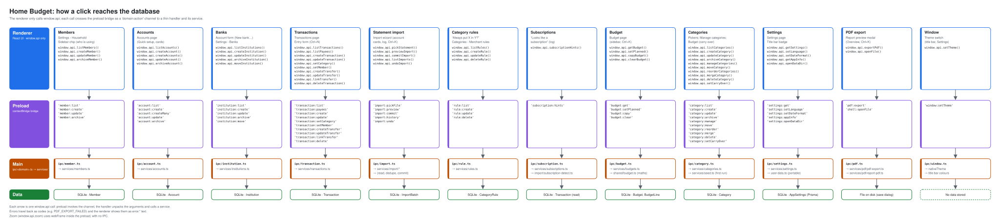

# System Architecture

## Process Architecture



Generated from `diagrams/architecture.json` by `/redraw-diagram`, which checks every channel against the code.

**Rule**: Never import Prisma, better-sqlite3 or fs in the renderer.

## IPC Pattern

```ts
// Renderer: window.api.setLanguage('en')
// Preload:  setLanguage: l => ipcRenderer.invoke('settings:setLanguage', l)
// Main:     ipcMain.handle('settings:setLanguage', (_e, l) => setLanguage(l))   // service call only
```

Errors are thrown as code strings (e.g. `'INVALID_LANGUAGE'`) and mapped to `error.*` i18n keys in the renderer.

**Transport-agnostic services.** Handlers only unpack arguments and call a service in `src/main/services/`. Services
take plain data and return plain data (no `event`, no `BrowserWindow`). If the app later needs several PCs or a web
version (see roadmap, *Needs a decision*), the same services can sit behind an HTTP or sync layer and `window.api`
behind a transport adapter, without rewriting business logic.

## Project Structure

```
src/main/
  index.ts                   Window, startup (portable check → migrations → settings → handlers), clean shutdown
  user-data.ts               Portable edition: marker detection, data folder next to the exe
  ipc/                       One file per domain: settings, pdf, window, member, account, category, transaction, import, rule, subscription, budget
  services/                  Business logic (settings, members, accounts, categories, transactions, rules, budgets, import/, pdf/)
  services/pdf/              report-pdf.ts (ReportDocument → PDF, pdf-lib), pdf-export.ts (save dialog), pdf-text.ts
  db/                        migrate.ts, prisma.ts, db-path.ts, pragmas.ts (journal mode), startup-backup.ts
src/shared/                  Pure code used by both processes
  money.ts                   formatMoney / parseMoney / sumMoney (integer cents)
  date-format.ts             formatDate / formatDateTime in the chosen format
  report-document.ts         Printable report model (zod), shared by the PDF and its on-screen preview
  budget.ts                  Budget types and maths (actual, carry, left to budget / to spend)
  search-normalise.ts        Greek → Latin, accent-free text for search
src/preload/index.ts         contextBridge → window.api
src/renderer/
  index.html
  src/
    App.tsx                  Shell: TitleBar + Sidebar + routed view, zoom, shell shortcuts
    assets/theme.css         Colour tokens (light + .dark), shell CSS
    assets/index.css         Component classes (.btn-*, .badge-*, .amount-*, .card, .input-field …)
    components/ui/           Design-system primitives (see UI Primitives)
    components/shell/        TitleBar, Sidebar, icons
    hooks/                   useThemeSync, useSidebarResize
    lib/                     nav-items, ui-actions, transitions, date-format, ipc-errors
    pages/                   OverviewScreen, SettingsScreen, PlannedScreen (placeholder for unbuilt areas)
    store/ui.ts              Theme, sidebar, folded cards, tour seen (persisted); palette, tour step (session)
    i18n/                    el.json, en.json
prisma/
  schema.prisma              SQLite schema
  migrations/                SQL applied at startup
```

## Navigation

Sidebar (`lib/nav-items.ts`): **Overview**, Transactions, Budget, Accounts & cards, Subscriptions & bills,
Debts & loans, Projections, Reports; footer: **Settings**. Default view: `overview`. Areas not built yet render
`PlannedScreen` with a one-line description of what they will do.

## Theme & Shell

- Frameless window; the renderer draws a 36px `TitleBar` (drag region) and Windows keeps native caption buttons via
  `titleBarOverlay`, recoloured on theme change (`ipc/window.ts`).
- Theme: Light / Dark / System (`store/ui.ts`), applied as `.dark` on `<html>` before first paint (`main.tsx`) and
  kept in sync with `nativeTheme`. Colour changes fade (`theme-anim`), sidebar side swaps use a view transition.
- Sidebar: resizable (drag, arrows, double-click resets), collapsible to icons (`Ctrl+\`, hover cards name each
  item), left or right (`Ctrl+Shift+\`). Zoom: `Ctrl +`, `Ctrl −`, `Ctrl 0` and the titlebar control.
- Shortcuts live in one table (`hooks/useShortcuts.ts`); `Ctrl+K` opens the command palette
  ([features/command-palette.md](features/command-palette.md)); a spotlight tour runs once
  ([features/app-tour.md](features/app-tour.md)).

## UI Primitives

`src/renderer/src/components/ui/` is the single source for shared UI; pages compose it and never hand-roll button,
badge or modal styles.
- **Styles** live only in `assets/index.css`; colours are tokens in `assets/theme.css`
  (`--c-success|danger|warning|neutral|info-{bg,fg}`, `--c-surface-hover`, `--c-surface-input`,
  `--c-chart-income|expense`) and flip under `.dark`.
- **Components**: `Button` (primary/secondary/ghost/danger/success/warning/finalize, `loading`), `IconButton`,
  `Badge`/`StatusBadge` (payment status)/`DraftBadge`, `Money`, `StatTile`, `Modal` (Escape, focus trap), `ConfirmDialog`,
  `Field`/`Input`/`Select`/`Textarea`, `PageHeader`, `ListCard`/`ListHeader`/`ListRow`/`RowTitle`/`MetaLine`/`SortHeader`,
  `TABLE_ROW`, `CollapsibleCard`, `CopyButton`, `Pagination`, `Segmented`, `Popover`, `SelectMenu`,
  `MultiSelectDropdown`, `FilterPopoverButton`/`FilterChip`/`ActiveFilterPills`, `Banner`, `Spinner`.
- **Layering**: sticky headers `z-10`; dropdowns, popovers and modals `z-50` (floating panels portal to `<body>`);
  toast `z-[60]`. Rows are 48px (`h-12`).

## Internationalization (i18n)

- Every visible string uses `t('key')`; Greek (`el`) is the default and fallback, English (`en`) the alternative.
- The language is stored in `AppSettings.language` (and `localStorage` for the first paint); changing it also switches
  date month names and the money format (`el-GR`: `1.234,56 €`, `en`: `€1,234.56`).

## Build & Development

```bash
npm run dev          # Electron + Vite HMR
npm run typecheck    # main + renderer
npm test             # Vitest
npm run build        # → dist/HomeBudget-Setup-<version>.exe + dist/HomeBudget-Portable-<version>.zip
```

**Database**: SQLite at `%APPDATA%\home-budget-planner\home-budget.db` (portable: `HomeBudget-data/` next to the exe,
see [features/portable.md](features/portable.md)), migrated at startup by `src/main/db/migrate.ts`.
**Node.js**: 22.14+ required.
